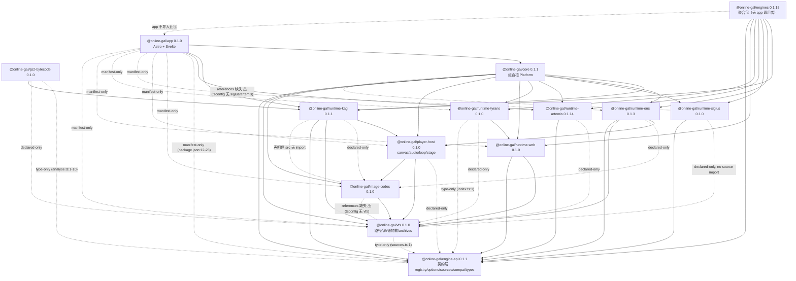

# 当前状态基线（Current State）

> **审计戳（快照）**：2026-10-13，仓库 `D:/online_gal`，branch `main`，HEAD `9dd18ecfd3de16f5b271c34e87a31aea30c753d6`（`docs: record animation timing fix completion`），与 `origin/main` 同点，无 submodule，无内嵌 token 的 remote。本轮前基线：**800 tracked / 65 untracked / 11 个 ` M`**（`.test/audit-round1-ce058ba0/snapshot/`）。
>
> **当前工作树（编写本文件时）**：**12 个 ` M`**、30 个 `??` 目录/文件（其中 3 个是本轮新增文档目录）。多出的第 12 个 modified 是 **`.gitignore`**（不在快照的 11 个之内），它新增了一行忽略规则 `MEMD.md`；作者**未知**，本轮与文档写作者无关联，**不得**改写、还原或归因。详见 §1.2「保护异常」。
>
> **本文件的 `路径:行号` 混合了两种时点**：§1–§4 的引用来自**快照/HEAD** 阅读；§5 finding 的坐标按**各自条目内标注**为准（`check-layout` 坐标是 checker 坐标，见 F-LAY-1）。凡行号随行会再变的，均在条目内写明时点。
>
> **证据等级图例（全文适用）**
>
> - **已观察**：本轮直接读到源码 / 跑过只读命令，附 `路径:行号` 或命令输出。
> - **已确认约束**：可由已观察源码直接推出、不需要运行的结构性结论。
> - **推断**：由间接证据得出，未留存原始输出或未运行验证。
> - **未验证假设**：需要运行或外部信息才能确认；**不得**读成缺陷已发生。
> - **未知**：本轮没有采集到任何证据。
>
> 本文只描述**当前状态**。目标状态见 `target-state.md`，迁移见 `migration-plan.md`，约束见 `module-dependency-rules.md`。本文不构成"仓库已全部审计"的声明：末尾「未覆盖与未知」逐条列出没有证据的面向。

---

## 1. 审计戳、工作区与历史

### 1.1 基线（已观察）

| 项 | 值 | 证据 |
| --- | --- | --- |
| branch | `main` | `git rev-parse --abbrev-ref HEAD` |
| HEAD | `9dd18ecfd3de16f5b271c34e87a31aea30c753d6` | `git rev-parse HEAD` |
| `origin/main` | 与 HEAD 同点 | `git rev-parse origin/main` |
| index | 空（无 staged） | `git status --porcelain` 无 `M `/`A `/`D ` 行 |
| remote | 仅 `origin https://github.com/fylcr/online_gal.git`（fetch+push） | `git remote -v` |
| submodule | 无 | `git submodule status` 空 |
| tracked | **800** | `git ls-files -z \| wc` |

### 1.2 工作区 ≠ HEAD 的差异（已观察）

- **11 个 tracked 文件在快照时已是 modified**（` M`；index 为空，因此这 11 个文件的**工作树内容**与 HEAD 不同）。这 11 个文件在本轮**字节未变**（逐文件 sha256 与 `snapshot/tracked-hashes.sha256` 相同；见 §1.2.1）：

  | 路径 | 备注 |
  | --- | --- |
  | `docs/artemis-official-compat-handoff.md` | 受保护，不 stage |
  | `docs/current-work.md` | **受保护**，本轮不编辑；checkpoint 由 supervisor 之后单独授权 |
  | `docs/session-5697f1a7-handoff.md` | `AGENTS.md` 明确不 stage |
  | `packages/runtime-artemis/src/compat/compat-worker.js` | |
  | `packages/runtime-artemis/src/compat/runtime.ts` | |
  | `packages/runtime-artemis/src/compat/worker-host.ts` | |
  | `packages/vfs/src/sources.ts` | |
  | `ports/artemis/compat-web/PLATFORM-PATCHES.txt` | |
  | `ports/artemis/compat-web/build.sh` | |
  | `ports/artemis/compat-web/overlay/cmake/web.cmake` | |
  | `ports/artemis/compat-web/overlay/host/web_main.cpp` | |

  **注意术语**：`M` 是"与 HEAD 不同"，**不是**"与 HEAD 相同"。本轮能说的是"这些文件在本轮前后字节不变"，不是"它们未被修改"。

#### 1.2.1 保护异常（.gitignore，作者未知）

- **第 12 个 modified：`.gitignore`**。它**不在**基线 `git-status-porcelain-z.bin` 的 11 个 ` M` 之列，是快照之后出现的改动。
  - 快照哈希：`c1168c427761fc950de9d225f829a34128c011ee23e3272e189e720273b504c4`（4265 B，等于 `HEAD:.gitignore`）
  - 当前哈希：`9434290335af8e88c71f34e65d88bac5b4d1989b67735e56d7166ef808a95c4f`（4273 B）
  - `git diff -- .gitignore` 只增一行：`+MEMD.md`。
- 随之出现的新根文件 **`MEMD.md`（100 B，untracked）** 被该规则隐藏。它**不在** 65 个基线 untracked 之列。
- **本轮文档写作者未写、未读、未改这两者**；作者**未知**，且**无法**在本轮归因或安全还原（改动属别人的工作）。**处理方式：只披露，不改。** 参见 `../governance/repository-risk.md` R-12。

#### 1.2.2 保护结论（不是 ALL-PASS）

| 检查 | 结果 |
| --- | --- |
| HEAD | `9dd18ec…` 不变；`origin/main` 同点 |
| index | 800 条，`git diff --cached` 为空 → **0 staged**，与基线 `index-ls-files.txt` 一致 |
| 800 tracked 内容 | **799/800 与快照逐字节相同**；唯一差异是 `.gitignore`（上述异常） |
| 11 个基线 dirty 文件 | **全部 SAME**（被保留，未被 reset 回 HEAD） |
| 65 个基线 untracked | **65 SAME / 0 MISSING / 0 DIFF** |
| 当前 untracked（`-uall`） | **85** = 65 基线 + **20 个本轮新增** |
| 最终工作树 diff | **不是零**（`.gitignore` + 20 个新文件） |

**因此整体保护结论是「HEAD/index 被保留 + 指定写作者未改任何既有文件」，而 NOT all-pass。** 不得写成"今天 800 个全部未变"。
- **65 个 untracked non-ignored 条目**：`.dsh/`、`.pi/`（agent 工具）、`openspec/`（脚手架）、`packages/runtime-artemis/src/compat-clean/`、`ports/artemis/compat-web-clean/`、`ports/artemis/compat-web/overlay/{render,script}/`、`patches/0006-*.patch`、`tests/fixtures/animation-observe/path-string.h`、根级 `ANIMATION_FIX_REPORT.md`/`RUNTIME_FIX_SUMMARY.md`/`build-wasm-animation-fix.sh`/`derived-provenance.json`/`smolvm-artemis.yml`/`Smolfile`/`COMPAT`(0B)/`NO_COUNTERPART`(0B)/5 个 `f3120..f3124__*.pseudoc`、`docs/artemis-{compat-clean-base,rewrite-r1,r2,r3,r4}.md`。
- **保护复核（时间限定）**：`.test/audit-round1-ce058ba0/snapshot/tracked-hashes.sha256`（800 行）与 `untracked-hashes.sha256`（65 行）在本轮文档写入后曾用 `sha256sum -c` 复核，**两者均 exit 0**。这是**快照时点**的结论：此后 `.gitignore` 出现外部改动（§1.2.1），所以该 "800/65 PASS" 是**有时间界的**，不是"今天仍然全绿"。**不得**更新受保护的 `.test` 快照。**未**做全树哈希：被 gitignore 的产物（`dist/`、`apps/app/.astro/`、`*.tsbuildinfo`、`node_modules/`）只有 mtime 检查。
- **范围限制（重要）**：被 gitignore 的产物（`dist/`、`apps/app/.astro/`、`*.tsbuildinfo`、`node_modules/`）只做过 **mtime-only** 检查，**没有**全树哈希。不能声称"整个工作树未变"。

### 1.3 目录计数（已观察）

| 顶层 | tracked 文件数 |
| --- | ---: |
| `ports` | 559 |
| `packages` | 144 |
| `test` | 29 |
| `docs` | 19 |
| `apps` | 17 |
| `.github` | 16 |
| `scripts` | 4 |
| 根文件 | 12 |

根文件 12 = `package.json`、`pnpm-lock.yaml`、`pnpm-workspace.yaml`、`tsconfig.base.json`、`tsconfig.json`、`tsconfig.packages.json`、`AGENTS.md`、`README.md`、`LICENSE`、`THIRD_PARTY_NOTICES.md`、`.gitignore`、`.gitattributes`。

> 早期侦察报告曾把 `docs` 数成 18、顶层切分错误。实际是 **19**；上表第 19 项是 `docs/项目状态与恢复指南.md`（UTF-8 中文文件名，不是带引号的坏路径）。

### 1.4 工具链（已观察）

| 工具 | 本轮本机版本 | 来源 |
| --- | --- | --- |
| Node | `v26.8.2` | `node --version` |
| pnpm | `9.14.2` | `pnpm --version`（与 `package.json` 的 `packageManager` 一致） |
| tsc | `5.9.3` | `node_modules/.bin/tsc --version` |
| Astro | `5.18.2` | `apps/app/node_modules/astro/package.json`（**不是** Astro 4） |
| jsdom | `30.1.0` | `node_modules/jsdom/package.json` |
| OpenSpec | `1.14.1` | 全局 `openspec --version`（`@fission-ai/openspec`，**非**仓库依赖） |

`package.json:8-9` 的 `engines.node` 是 `>=20`；**CI pin 的是 `'22'`**（`.github/workflows/build-packages.yml:160`、`build-wasm-artemis-engine` 组的 `build-wasm-artemis-bridge.yml:118`）。本机 v26.8.2 满足下限但是**更新的未 pin 大版本**，因此本轮日志**不是 CI 复现**。

---

## 2. 全局模块索引

### 2.1 Packages（13）+ app（已观察：manifest、tsconfig、入口）

全部 13 个包：`private: true`、`type: module`、`license: GPL-3.0-or-later`、`main: ./dist/index.js`。`exports` 一律 `types`/`development` → `src/*.ts`，`default` → `dist/*.js`。**源码入口与构建产物入口是真实分叉**，不是推断。

| 包 | 版本 | manifest workspace 依赖 | tsconfig references | src 顶层入口（真实模块面） |
| --- | --- | --- | --- | --- |
| `@online-gal/engine-api` | 0.1.1 | 无 | 无 | `caps`/`compat`/`options`/`registry`/`sources`/`types` |
| `@online-gal/vfs` | 0.1.0 | engine-api | engine-api | `bytes`, `composite`, `host-source`, `lazy`, `path`, `sources`, `sync-bridge`, `archives/`；子导出 `./archives` |
| `@online-gal/image-codec` | 0.1.0 | vfs | **无** | 浏览器解码 + TGA |
| `@online-gal/player-host` | 0.1.0 | engine-api, vfs, image-codec | 同三项 | `assets`, `audio`, `input-gate`, `loop`, `presentation`, `presenter`, `stage`, `text` |
| `@online-gal/tjs2-bytecode` | 0.1.0 | engine-api, vfs, runtime-kag | 同三项 | `analyse`, `container`, `disassemble`, `opcodes`, `script-bytes` |
| `@online-gal/runtime-kag` | 0.1.1 | engine-api, vfs, image-codec, player-host | 同四项 | `compiled`, `runtime`, `scene`, `script`, `wasm-config`, `wasm-page`, `wasm-provider`, `wasm-runtime`, `tjs/` |
| `@online-gal/runtime-ons` | 0.1.3 | engine-api, vfs, image-codec, player-host | 同四项 | `container`, `nscript`, `runtime`, `save-storage`, `wasm-provider`, `wasm-runtime`, `wasm/`；`build` 含资产拷贝 |
| `@online-gal/runtime-siglus` | 0.1.0 | engine-api, vfs | 同两项 | `gameexe`, `probe`, `runtime` |
| `@online-gal/runtime-artemis` | 0.1.14 | engine-api, vfs | 同两项 | `assets`, `browser-services`, `configure`, `compat/`, `compat-clean/`, `host/`, `pfs`, `probe`, `runtime`；子导出 `./compat` |
| `@online-gal/runtime-web` | 0.1.0 | engine-api, vfs | 同两项 | `root`, `runtime` |
| `@online-gal/runtime-tyrano` | 0.1.0 | engine-api, vfs, runtime-web | 同三项 | provider 子类 + shim |
| `@online-gal/core` | 0.1.1 | engine-api, vfs, image-codec, player-host, runtime-{kag,ons,siglus,artemis,tyrano,web}（10 项） | **8 项**（缺 runtime-siglus、runtime-artemis） | `capabilities`, `db`, `library`, `platform`, `session`, `storage`, `types` |
| `@online-gal/engines` | 0.1.15 | engine-api + 六个 runtime | 同七项 | 单文件 `index.ts`（provider 聚合 + `export * from '@online-gal/engine-api'`） |
| `@online-gal/app` | 0.1.0 | core, engine-api, image-codec, player-host, runtime-{artemis,kag,ons,tyrano,web}, vfs | 不在 packages solution | Astro 静态壳 + 4 个 Svelte 组件 |

**已确认约束（三条声明/使用不一致 + 一条未使用声明）**：

1. `packages/core/package.json` 依赖 `runtime-siglus`/`runtime-artemis`，`packages/core/tsconfig.json` 的 references **没有**它们，而 `packages/core/src/platform.ts:5-6` **值导入**它们。manifest / TS build graph / 源码 import 三者不一致（**潜在**：当前 `tsc -b tsconfig.packages.json` 在隔离副本上 exit 0，见 `../development/testing.md` §3）。
2. `packages/image-codec/package.json` 依赖 `vfs`，`packages/image-codec/src/index.ts:1` 值导入 `vfs` 的 `extname`，`packages/image-codec/tsconfig.json` **没有 references**。
3. `apps/app` **不**依赖 `@online-gal/engines`、`runtime-siglus`、`tjs2-bytecode`；但它的 manifest `dependencies` **包含** `engine-api`、`image-codec`、`player-host`、`runtime-ons`、`runtime-tyrano`、`runtime-web`、`vfs`（`apps/app/package.json:12-23`），远多于启动链实际使用的三包（§4.1）。**manifest 边多于真实 import 边** —— 这本身不是缺陷，但它意味着"看 manifest 就能推启动边"是错的。
4. `@online-gal/runtime-siglus` 在 `packages/runtime-siglus/package.json:20` 声明 `vfs`，但 `packages/runtime-siglus/src/**` 中**没有任何** `@online-gal/vfs` import。归类为**声明但未使用的潜在依赖**，**不是**运行时依赖。

### 2.2 Runtime 注册表（已观察）

`packages/engines/src/index.ts` 的 `ENGINE_PACKAGES` 注册 **8 个 runtime id**（不是 5 个 WASM）：

| # | `runtimeId` | kind | 包 | 可用性来源 |
| --- | --- | --- | --- | --- |
| 1 | `krkr2-wasm` | engine | runtime-kag | `wasm-provider.ts` `availability: 'runnable'`，实际要 `pageUrl` |
| 2 | `krkr2` | interpreter | runtime-kag | TS 解释器（明文 KAG 回退） |
| 3 | `onscripter-wasm` | engine | runtime-ons | `wasm-provider.ts` `availability: 'runnable'` |
| 4 | `onscripter` | interpreter | runtime-ons | TS 回退 |
| 5 | `siglus` | shell | runtime-siglus | `siglusEngineHosts.length > 0 ? runnable : unavailable`（当前无 host → 仅识别） |
| 6 | `artemis` | engine | runtime-artemis | 未配置 compat 时 unavailable |
| 7 | `tyrano` | engine | runtime-tyrano | 复用 web runtime |
| 8 | `web` | engine | runtime-web | HTML/RPG Maker/NW.js，放最后使裸 `index.html` 不越级 |

`assertNoDuplicateIds`（同文件）在**模块加载期**抛错，防止重复 id 静默取胜。

**WASM 构建线的真实边界**：有 WASM 构建线的是 **ONS、KiriKiri、Artemis compat**，另有 legacy Artemis bridge（仅 manual dispatch）；Tyrano/web 是页面运行时，不是自有 WASM。`README.md` 的可运行叙述覆盖 KiriKiri/ONS/Tyrano/RPG Maker/HTML5；Siglus 仅识别；Artemis compat 已编译但**不得**标可玩；Ren'Py 仅识别且无探针。

### 2.3 端口与工具（`ports/`，已观察目录 / 未逐文件读）

- `ports/artemis/`：`README.md`、`REWRITE.md`（重写风格宪法）、`rewrite-names.tsv`；`src/`（手写 C++ 产品，**340 个 `.cpp` + 2 个 `.h`**，按 `THIRD_PARTY_NOTICES.md` 声明为产品，但 asyncify bridge 仍留有未替换的 SDK 生成体）；`compat-web/`（**出货路线**：`build.sh`、`RUN-BUILD.sh`、`make-source-bundle.mjs`、`PLATFORM-PATCHES.txt`、`patches/0001..0006`、`tests/*.test.mjs` 6 个、gitignored `out/`）；`compat-web-clean/`（**untracked 新净线**）；`reverse/`、`tools/`、`harness/`、`vendor/artemis-sdk/`、`build/`、`out/`、`rewrite-staging/`、`rewrite-fixes/`。
- `ports/ons/`、`ports/krkr/`（`kirikiroid2/`、`krkrsdl2/`）、`ports/lib/`（`engine-artifacts.json` ledger、`fetch-engine.mjs`、`ref.mjs`）、`ports/env.sh`、`ports/README.md`。

#### 2.3.1 非 Artemis 覆盖表（**已读源码**，不是只列目录名）

| 位置 | 入口/文件（已读） | 许可 / pin | 构建契约 | 测试 | 未知 |
| --- | --- | --- | --- | --- | --- |
| `ports/ons` | `README.md`、`build/ons_host_shim.{h,cpp}`、`build/run-web-build-shimmed.sh`、`build/fetch-web-engine.sh`、`harness/` | GPL-2.0-or-later；上游 `YuriSizuku/OnscripterYuri` `master` @ `08f744b31cc1907b66a15f0402e62321a131ed81`；emsdk 6.0.9 | `.github/scripts/build-ons.sh`（CI 主入口）→ `build-wasm-ons.yml`；shim force-include 到 `SDL_WaitEvent` 之前；上游 `script/cross_web.sh` **未改** | 无 tracked 测试；工作台有 `ons*`/`ons-wasm-provider`（gitignored，**未运行**） | 真实游戏可用性；`harness/` 内各服务器脚本未逐个读 |
| `ports/krkr` | `README.md`、`kirikiroid2/patch-vlfs-host-source.mjs`、`kirikiroid2/overlay-ports/{gettext,libexif}/**`、`kirikiroid2/run-build.sh`、`kirikiroid2/{browser-test,diag-*,verify-*}`、`krkrsdl2/`（已替代路线） | 上游 README 写 "MIT" 但实际 LICENSE 是日文 BSD 风格 Kirikiri/W.Dee + 依赖 notices；overlay port：gettext GPL-3.0-only、libexif LGPL-2.1-or-later；pin `13dda190f8370d02b6cf59286a088529b355658c`（`web`）；vcpkg `b1e15ef…`（需完整历史） | `.github/scripts/build-krkr.sh` → `build-wasm-krkr.yml`；`SOURCE_DATE_EPOCH` + `TZ=UTC` + `VCPKG_KEEP_ENV_VARS` 保证可复现；输出 6 个页面文件 | 无 tracked 测试；工作台有 `kiri-*`（gitignored，**未运行**） | 真实游戏可用性；`overlay-ports` 内每个 patch 的逐文件许可归因 |
| `ports/lib` | `engine-artifacts.json`（ons + krkr 台账）、`fetch-engine.mjs`（22.2 K）、`ref.mjs`（2.4 K） | n/a（本地工具） | URL 形状 `https://github.com/fylcr/online_gal/releases/download/<tag>/<name>`；下载**先校验大小+sha256 再改名落位**；exit 2 = 资产不可用（ONS 可回落源码构建），exit 3 = 校验失败（**必须停止**）；`--staged` 之外只读工作树 | 无 tracked 测试 | 远程 release 资产是否存在；台账新鲜度（手工更新，无强制） |
| `ports/env.sh` / `ports/README.md` | 共享路径解析（显式 env → 本机常规位置 → 仓库内位置，幂等）；`ports/README.md` 记录主构建入口表 | n/a | `ports_unix`/`ports_win` 在非 Git Bash 上为恒等函数 | 无 | 每个历史脚本能否在任意机器直接运行（README 已声明不保证） |

**上表依据的头部文件均已读过**；交叉引用：`[ports/README.md](../../ports/README.md)`、`ports/ons/README.md`、`ports/krkr/README.md`、`ports/env.sh`、`ports/lib/{engine-artifacts.json,fetch-engine.mjs,ref.mjs}` —— 表中每行的入口/配方/台账路径都可在这些文件中复核。`ports/artemis/**` 的细节见 §2.3 与 `../governance/third-party-inventory.md`。此前报告只列了这些目录名，本表补上入口/许可/pin/契约/测试/未知四类，**仍未**逐文件读完 `harness/`、`browser-test/`、`overlay-ports/` 的每个文件。

#### 2.3.2 文档漂移（**下一阶段事项，本轮不修改**）

- `packages/runtime-artemis/README.md:8` 仍写 `ArtemisRuntime.load()` "still throws `UnsupportedEngineError`"；而根 `README.md:661` 与 `runtime.ts` 现状是 `load()` **不再无条件抛错**（默认 `CompatArtemisRuntime`）。**包内 README 陈旧**，与根 README 和实现不一致。
- 根 `README.md` 的 Artemis pin 自身不一致：`:640` 写 `17200e64ea99681e3c27d694433c0ff78d7a7cee`，`:667` 写 `9f622629…`，`:854`（表格）写 `9f62262…`，`:875` 又回到 `17200e64…`。属**文档漂移**，与 F-GOV-3 的 pin 冲突同源。
- **两者本轮均不改**（它们是产品/文档文件，不在本变更的写域内）；登记为下一阶段文档修正项。**不得**由此推断引擎可用性。
- **`ports/artemis/vendor/artemis-sdk/` 的 9 个 blob 由 `git ls-tree -r -l HEAD` 证明在 HEAD 内**（约 24 MB）：

  | 文件 | 字节 |
  | --- | ---: |
  | `Android/arm64-v8a/libartemis.so` | 8,149,024 |
  | `Android/armeabi-v7a/libartemis.so` | 7,395,052 |
  | `Copyright.txt` | 20,717 |
  | `WebAssembly/artemis.{html,js,wasm}` | 3,912 / 264,298 / 2,682,787 |
  | `WebAssembly/asyncify/artemis.{html,js,wasm}` | 3,912 / 276,695 / 5,998,665 |

  `Copyright.txt:1` = `Artemis Engine` / `Copyright (C)2009 Daiju Hanaoka (Mikage) All rights reserved.` 其后再附第三方 notices。**再分发状态未解决**，见 `../governance/third-party-inventory.md`。

### 2.4 工具、测试与 CI（已观察）

- `scripts/`：`check-layout.mjs`、`check-sources.mjs`、`run-tests.mjs`、`run-portable-tests.mjs`。
- `test/`：**29** 个 `.mjs`（`artemis-*.test.mjs` 为主）+ `fixtures/` + `artemis-animation-observe-portable/`。
- `ports/artemis/compat-web/tests/`：**6** 个原生探测测试。
- **tracked 测试文件合计 35**（29 + 6）。这是**工具计数**，不是覆盖率。
- 被 gitignore 的 `.test/` 工作台：**26** 个顶层 `*.test.ts` + 252 个顶层子目录（名字索引，未运行）。
- `.github/workflows/`：**7** 个（`build-packages`、`build-wasm-reusable`、`build-wasm-ons`、`build-wasm-krkr`、`build-wasm-artemis-compat`、`build-wasm-artemis-bridge`、`check-upstream-drift`）。
- `.github/scripts/`：**8** 个（`build-artemis-bridge.sh`、`build-artemis-compat.sh`、`build-krkr.sh`、`build-ons.sh`、`check-drift.mjs`、`make-manifest.mjs`、`make-package.mjs`、`smoke-consumer.mjs`）。
- `.github/upstream-pins.json`：`emsdk`、`engines.{ons,krkr}`（可 dispatch）、**兄弟键** `artemis-compat`（出货）与 `artemis-bridge`（legacy/diagnostic，**不被 drift 自动 dispatch**）、`tools.{vcpkg,wabt}`。

---

## 3. 依赖图（已验证边）

**图例（重要）**：

- **实线 `-->`** = **实际值 import**（已读源码行号，见 §3.1）。这是真正的构建期/运行期依赖。
- **虚线 `-.->`** = **仅类型 import**（`import type`）或**只在 manifest/references 声明、源码未见 import**；两者都用标签区分：`type-only` / `declared-only`。**不构成值依赖**，也不构成运行时依赖。
- **图完整覆盖 13 个包 + app 的全部 manifest 边**；每条边的形状由上面的两种线型表达，没有任何边被省略。

**本图不声明任何边是"运行时调用边"**，也**不是运行时 SCC 证明**：它是**静态声明与静态 import** 的图。运行时 service 调用（例如通过 registry 间接调用某个 provider）**不在**本图覆盖范围内。

**已确认约束（图的性质）**：

- 图 **覆盖全部 13 个包 + app 的 manifest 边**；已读源码可确认的值边只有：`image-codec→vfs`、`player-host→{vfs,image-codec}`、`tjs2→runtime-kag`、`web→{vfs,engine-api}`、`siglus→engine-api`、`artemis→engine-api`、`tyrano→runtime-web`、`core→`（十边，`platform.ts:1-8`）、`engines→`（七边，`index.ts:14-22`）、`app→{core,runtime-kag,runtime-artemis}`（`apps/app/src/lib/platform.ts:7-11`）。其余跨包边标为 `declared-only`（manifest/references 声明但未逐条验证源码值使用），**不得**读成运行时依赖。
- 由 manifest + tsconfig references + comment-stripped 静态 import 正则三者交叉核对，**每个包自成一个 singleton**（静态声明的图里无任何大小的环）。先前报告提出的 `runtime-kag ↔ tjs2-bytecode` 环已被推翻：`runtime-kag` 的 manifest/references 都不含 `tjs2-bytecode`，`packages/runtime-kag/src/runtime.ts:40` 对它的唯一提及是**注释**（"inlined rather than imported"），`runtime-kag/src/compiled.ts:10` 只值导入 `@online-gal/vfs/archives`。依赖方向只有 `tjs2-bytecode → runtime-kag` 单向（`packages/tjs2-bytecode/src/script-bytes.ts:11-12` 的值再导出）。
- **正则的限制（必须保留）**：该扫描不解析 `require()` 字符串字面量、生成代码、非字面量动态 `import()`，因此**不能**证明"不存在运行时 service 环"；它证明的是"不存在声明或静态 import 的边"。**不要**把这张图当运行时 SCC 图。
- `import type` 只产生类型边，**不算**值环（`packages/vfs/src/sources.ts:1`、`packages/runtime-tyrano/src/index.ts:1`、`packages/tjs2-bytecode/src/analyse.ts:1-10` 均为此类）。
- **`engines` 没有产品调用者**：`apps/app/src/lib/platform.ts:7-11` 值导入 `core`、`runtime-kag`、`runtime-artemis`，**不含** `engines`；app manifest 里的 7 条额外依赖是**声明边**而非启动边。
- **同一组 provider 被两处手写**：`packages/core/src/platform.ts:21-39`（`BUILTIN_PROVIDERS`）与 `packages/engines/src/index.ts:99-148`（`ENGINE_PACKAGES`）列同一组 8 个 provider，顺序一致但各自维护。
- **build-graph 不一致仍是"潜在"**：`core` 的 references 缺 `runtime-siglus`/`runtime-artemis`、`image-codec` 缺 `vfs` reference —— 这两条会改变 `tsc -b` 的拓扑顺序，但当前 `tsc -b tsconfig.packages.json` 在隔离副本上 **exit 0**，所以本轮**没有**观察到构建失败；归类为潜在风险，不是已发生的构建错误。

### 3.1 跨包 import 抽样（已观察，非全仓扫描）

- `packages/core/src/platform.ts:1-8` 值导入 engine-api、vfs、runtime-{kag,ons,artemis,siglus,tyrano,web}。
- `packages/core/src/session.ts:1-11` 值导入 engine-api、player-host。
- `packages/core/src/storage.ts:1` 值导入 vfs 的 `IndexedDbStore`。
- `packages/core/src/library.ts:1-16` 值导入 engine-api、vfs、`@online-gal/vfs/archives`。
- `packages/engines/src/index.ts:14-22` 值导入 engine-api + 六个 runtime，并 `export * from '@online-gal/engine-api'`（**值再导出**，不是 `export type`）。
- `packages/image-codec/src/index.ts:1` 值导入 vfs 的 `extname`。
- `packages/tjs2-bytecode/src/script-bytes.ts:10-12` 值再导出 runtime-kag。
- `packages/runtime-tyrano/src/index.ts:1-2` 对 engine-api 是 `import type`（**类型边**），对 runtime-web 是值导入。
- `packages/vfs/src/sources.ts:1` 对 engine-api 是 `import type { GameSource, WritableStore }`（**类型边**）。
- `packages/tjs2-bytecode/src/analyse.ts:1-10` 对 engine-api 是类型导入，值导入本包模块。
- `@online-gal/runtime-siglus`：`packages/runtime-siglus/src/**` **无** `@online-gal/vfs` import（manifest 声明但未使用）。
- `apps/app/package.json:12-23` 的 manifest `dependencies` 共 10 项（含 `engines` 除外的 7 个额外包），而 `apps/app/src/lib/platform.ts:7-11` 只值导入 `core`、`runtime-kag`、`runtime-artemis`。
- `packages/runtime-artemis/src/compat/index.ts:1` 明确注释 worker **不能**导入该入口；worker URL 由页面配置传入。
- `apps/app/src/lib/platform.ts:7-11` 值导入 core、runtime-kag、runtime-artemis。

---

## 4. 真实调用链（已观察）

### 4.1 启动链

1. `apps/app/src/lib/platform.ts:52-56`：编译期 `__ARTEMIS_ASSETS_AVAILABLE__` 为真时调用 `configureArtemisCompat({ engineBase:'/engines/artemis-compat/', workerUrl:'/engines/artemis-compat/compat-worker.js' })`；为假即"引擎撤回"。
2. 同文件 `:58-60`：**仅** `import.meta.env.DEV` 时 `configureKirikiriWasm({ pageUrl:'/krkr2-web/index.html' })`。
3. 同文件 `:64-67`：`getPlatform()` 懒创建**唯一** `Platform`。
4. `packages/core/src/platform.ts:50-66`：构造 `RuntimeRegistry`、注册 `BUILTIN_PROVIDERS`、构造 `GameLibrary`、`SaveStore`、`SettingsStore`。
5. `apps/app/src/components/Player.svelte:41-53`：取 query `id` → `platform.library.openSource(record)` → `platform.saves.fileStore(record.id)` → `launchSession` 创建 `Session` 并 `start()`；`onDestroy` 调 `session.stop()`。
6. `packages/core/src/session.ts:197-205` `start` = `runtime.load()` → 循环 start → `runtime.render()`；`:226-229` `pause` = `this.runtime.pause()` 然后 `this.loop.stop()`；`:237-243` `stop` = `this.loop.dispose()` → `this.inputGate.reset()` → `this.detachInput()` → `this.runtime.dispose()`。**注意顺序：`stop` 先 dispose 循环，不是先 stop 循环。**

**这是宿主生命周期，不是引擎内部绘制证明。**

### 4.2 存档链

- `packages/core/src/storage.ts:9` `DB_NAME = 'online-gal'`；`:16-22` `SettingsStore` 的 `Database` 使用 `[settings, saves, games, fileIndex]`；`:58-64` `SaveStore` 用 `[saves, settings]`。
- `storage.ts:76-78` `SaveStore.fileStore(gameId)` → `new IndexedDbStore(\`saves:${gameId}\`, DB_NAME, STORE_SAVES)`；**硬编码在 `storage.ts:77`**，忽略 `SaveStore` 构造参数里的 `dbName`。
- `storage.ts:80-82` 槽键 = `` `${gameId}\u0000${slot.padStart(4,'0')}` ``。
- `packages/vfs/src/sources.ts:355-359` `IndexedDbStore(name, dbName='online-gal', storeName='saves')`；`:361-377` `indexedDB.open(dbName, 1)`；`:381-383` 键 = `` `${name}\u0000${normalisePath(path)}` ``；`:420-431` `list(prefix)` 剥掉 `` `${name}\u0000` `` 后返回，**保留 id 前缀**。
- `packages/core/src/library.ts:366-370` `openSource` 用 `new IndexedDbStore(\`saves:${record.id}\`, dbName, 'saves')` 包进 `OverlayGameSource(..., { writePrefix:'userfs' })` → 键形如 `saves:<id>\u0000userfs/<path>`。
- `library.ts:118-120` `remove` 的删除循环：`:119` `for (const path of await store.list(id))`，`:120` `store.remove(\`${id}/${path}\`)`；`:118` 是 `new IndexedDbStore('files', dbName, 'fileIndex')`。`list(id)` 已经返回带 id 前缀的字符串，再次拼 `${id}/` 得到 `<id>/<id>/<path>`，与写入键 `files\0<id>/<path>`（`:254` 写入处）不匹配。`library.ts:122-127` 删除 `saves` store 中以 `` `${id}\u0000` `` 开头的键，**捕捉不到** `saves:<id>\0...` 的 overlay 数据。`moveStoredFiles`（`:261-265`）有同一反向假设。
- `library.ts:282-283` `openStoredSource` 却是**正确**的：`paths.map(p => p.slice(id.length + 1))`，与 `IndexedDbStore.list` 的语义一致。

**已确认约束**：同一个 DB `online-gal`、同一个 object store `saves` 上至少有三类记录（槽 JSON、`SaveStore.fileStore`、`OverlayGameSource`）；删除路径与键形状不一致，`remove` 不会回收 overlay 字节。**未验证假设**：这会导致真实数据残留——本轮**没有运行复现**，因此**不升级为 P0**。UI 侧 `apps/app/src/components/Library.svelte:136` 承诺"其存档也会一并移除"。

### 4.3 Archive / 导入链

- `packages/vfs/src/archives/index.ts:24-31` 实际支持的格式只有 `.xp3`、`.zip`、`.nsa`、`.ns2`、`.sar`、`.asar`（**没有** RAR、没有 7z reader）。
- ZIP：`zip.ts:155-177` 先读 local header，再按 `compressedSize` 读整段压缩数据，然后 `inflateRaw`；中央目录按 `centralSize` 整段读。
- **range API 并非缺失**：NSA/ASAR/ZIP 都有真实的 `readRange`；缺少的是"把整段解码拆成流式"这一层，而不是底层不支持 range。先把这条前提读对，再看下面的峰值结论。
- `reader.ts:187-200`：解压结果 < 64 MiB 才进缓存，超限清空整缓存；**没有** per-entry release。
- `reader.ts:214-226`：`inflateRaw`/`inflateZlib` 用 `DecompressionStream`，但 `new Response(stream).arrayBuffer()` 把输出收成整段 `Uint8Array` —— 对**压缩成员**，对外仍是整成员缓冲（stored 成员可走 range）。
- `lazy.ts:148-156` `ArchiveEntryLazyFile.read`：有 range 回调就用，否则 `reader.readFile` 一次解出整成员并缓存。
- `host-source.ts:151-190`：按 key 缓存 handle；失败删缓存；`null` 永久记为不存在；**没有 release API**。`host-source.ts:172` 在包装层对 `length` 做 `void length`（只是不在包装层使用），但随后仍把 `length` 传给下层 `file.readRange` —— **不是"length 被忽略"**，而是包装层不消费它。
- `library.ts:230-253` dev local import 对 `__index.json` 每个文件 `response.arrayBuffer()` 后放进 `MemoryGameSource` —— **不是 lazy**，峰值是整份文件总和。`library.ts:256-265` 的 file import 先 `blob.arrayBuffer()` 再写入 IndexedDB —— 整份复制。
- `library.ts:300-325` 导入 archive 时 `openBlobArchive`；后续 runtime `readFile` 走 `ArchiveGameSource`（只有 `readFile`）。

**已确认约束**：`lazy` 命名**不能**当作峰值上限；**压缩成员**的解压会把压缩段与解压段同时放进内存。range 能力本身存在（NSA/ASAR/ZIP），缺的是流式/预算上限。

### 4.4 路径规范化

- `packages/vfs/src/path.ts:8-21` `normalisePath`：`\`→`/`、去前导 `/`、丢空段与 `.`、用 pop 吃掉 `..`（`..` 被**静默**丢弃，不报错）。
- `packages/engine-api/src/sources.ts:3-9` 另有一个 `normalise`：**不 pop `..`**。`MemoryGameSource`/`OverlayGameSource` 用它（`library.ts:7` 从 engine-api 导入）。
- `packages/vfs/src/sources.ts:37-41`：File System Access handle 额外拒绝 `.` 开头、含 `/` 或 `\` 的段（第二套规则，只覆盖 handle 路径）。

**已确认约束**：同一路径在两套 normalizer 下语义不同，且这条差异能到达导入链。**推断**：含 `..` 的路径在内存层与 archive 层可能指向不同键；未见已到达的逃逸写入。

### 4.5 存储与配额

- `packages/core/src/db.ts:11-48`：通用 IndexedDB wrapper，单连接缓存，`onversionchange` 关闭本连接，`onblocked` 拒绝；不创建索引。
- `packages/vfs/src/sources.ts:361-377` 的 `IndexedDbStore.open` **没有**同等的 `onversionchange`/`onblocked` 处理。
- `Settings.svelte:16` 只准备了 `storageEstimate` 状态；本轮**没有**读到配额恢复实现，**不能**声称有 quota 处理。
- `ensurePermission`（`library.ts` 后部）只在 directory reopen 时请求读权限，失败返回 `false`；**没有**持久化 permission grant。

---

## 5. Finding registry

**稳定 ID 规则**：`F-<域>-<序号>`。域：`LAY`（布局/门禁）、`DEP`（依赖图/构建）、`DAT`（数据契约）、`ARC`（archive/内存）、`GOV`（治理/CI/发布）、`TST`（测试）。**本轮没有任何已被证明的 P0**（见 5.9）。所有条目的"影响"在缺少运行复现时保持为 source-level contract 描述。

### F-LAY-1 — `check:layout` 在 HEAD 上失败（P1）

- **证据**：`node scripts/check-layout.mjs` exit **1**，报告 **4** 处违规。它的坐标是 **checker 坐标**：`check-layout.mjs` 只扫 `git ls-files` 下 `packages/`、`apps/`、`ports/` 的源码扩展名，并且**先做 `stripComments`**（多行块注释被折成一个空格），所以它报的行号与原始 `grep` 不同。
  - checker 坐标（文档引用并保留日志）：`ports/artemis/compat-web/tests/artemis-compat-first-transition.test.mjs:14`、`artemis-compat-tween.test.mjs:232`、`:233`、`:261`。
  - 原始源码坐标（`git show HEAD:<file> | grep -n '\.test/'`，**另记**）：`artemis-compat-first-transition.test.mjs:31`、`artemis-compat-tween.test.mjs:238`、`:239`、`:267`。
  - 两者指**同一批违规**；checker 坐标**不是陈旧的**。复现 `check-layout.mjs` 的 `stripComments` 语义可精确重现 `14 / 232 / 233 / 261`（本轮 09 最终评审独立复现过）。固定计数 = **4**。
- **影响**：`npm run check` 的第一步即 `check:layout`，因此在当前 HEAD 上**不可能通过**；`npm test` 同样以它开头。
- **证据强度**：强。两个违规文件都**不在** `git status --porcelain` 的 11 个 ` M` 之列，index 为空，因此它们的工作树内容 == HEAD（由 porcelain 推出，未另跑 `git diff`）。
- **复现**：`node scripts/check-layout.mjs`（只读，无副作用）。
- **建议范围**：仅这两个 tracked 测试文件，或把工作台路径改为运行期注入。
- **回滚**：单文件 revert。
- **人工确认**：需要——是否要让 `check` 在 HEAD 上可过属 owner 决定。
- **置信度**：高。

### F-LAY-2 — patch 清单契约在 HEAD 上漂移（P1）

- **证据**：`git --no-optional-locks show HEAD:ports/artemis/compat-web/PLATFORM-PATCHES.txt`（只读，**由本轮写作者与后续 scout 两次独立执行**）列出 **5** 项：`0001-pf8-readat-host-source.patch`、`0002-numeric-strto.patch`、`0003-tween-loopdelay.patch`、`0004-animation-dispatch-observe.patch`、`0005-compositor-update-first-frame.patch`。
  - **测试期望 4**：`test/artemis-compat-ci.test.mjs:357` 与 `:601` 都是 `assert.deepEqual(names, ['0001-pf8-readat-host-source.patch', '0002-numeric-strto.patch', '0003-tween-loopdelay.patch', '0004-animation-dispatch-observe.patch'])`（`read('ports/artemis/compat-web/PLATFORM-PATCHES.txt')` 一行一项）；`ports/artemis/compat-web/tests/artemis-compat-animation-observe.test.mjs:91` 是 `assert.equal(names.length, 4)`。
  - **工作树是 6**：多出 untracked 的 `0006-tween-arm-initial-value-trial.patch`。
  - **三个数字必须分开写**：HEAD = **5**（`git show` 已只读查证，不是推断）、工作树 = **6**、测试字面量 = **4**。
- **影响**：该测试在 HEAD 上失败（2 个断言，`assertEquals` 在 `:357` / `:601`）。工作树另有 untracked 的第 6 个 patch（`0006-tween-arm-initial-value-trial.patch`），**不得**把它当作 HEAD 内容——HEAD 是 5。
- **复现**：`node --test test/artemis-compat-ci.test.mjs`（本轮在隔离副本上跑过：`AssertionError … strictly deep-equal`）。
- **建议范围**：测试字面量或清单声明，二者取一；不改冻结哈希。
- **人工确认**：需要——是"HEAD 应有 5"还是"测试应期望 4"。
- **置信度**：高（`git show HEAD:` 已只读查证）。

### F-DEP-1 — `core` 的 TS build graph 漏掉两条真实 runtime 依赖（P1）

- **证据**：`packages/core/package.json` 依赖 `runtime-siglus`/`runtime-artemis`；`packages/core/tsconfig.json:7-16` 的 references 只有 8 项（无这两项）；`packages/core/src/platform.ts:5-6` 值导入二者。
- **影响**：增量 `tsc -b` 可能先构建 `core` 再构建被漏掉的 runtime，产生过期产物。**不是**数据丢失。**潜在**，不是已发生的构建失败：隔离副本上 `tsc -b tsconfig.packages.json` 是 **exit 0**（real 6.761 s）。
- **复现（待做）**：清理 `dist/` 与 `*.tsbuildinfo` 后跑 `tsc -b tsconfig.packages.json`，观察 core 是否落在两个 runtime 之后。**本轮未做该特定顺序验证**。
- **回滚**：分文件 tsconfig 变更，删两行即可。
- **置信度**：结构性高；运行影响未验证。
- **注**：`packages/image-codec/tsconfig.json` 缺 `vfs` reference 属**同类**缺口（`image-codec/src/index.ts:1` 值导入 vfs）。

### F-DEP-2 — `runtime-kag` 声明但未使用 `image-codec`（P3，待裁定）

- **证据**：`packages/runtime-kag/package.json` 与 `tsconfig.json` 声明/引用 `image-codec`；`runtime-kag/src` 无任何 import 命中。
- **影响**：可能是有意重导出，也可能是漂移。不构成构建失败。
- **人工确认**：需要（owner 裁定）。
- **置信度**：高（事实层面）；意图未知。

### F-DEP-3 — 同一组 provider 在两处手写（P2）

- **证据**：`packages/core/src/platform.ts:21-39` 与 `packages/engines/src/index.ts:94-137`。
- **影响**：以后加引擎可能只改一处；顺序影响 tie-break，进而影响识别结果。当前 app 启动走 `core`，**不**走 `engines`。
- **建议范围**：抽共享常量或让 core 依赖 engines；先确认没有外部消费者。
- **风险/回滚**：改变注册顺序会影响识别 → 必须先做识别回归；回滚为 revert。
- **人工确认**：需要。
- **置信度**：高。

### F-DAT-1 — `SaveStore.fileStore` 硬编码 DB 名（P2，潜伏）

- **证据**：`packages/core/src/storage.ts:77` 传 `DB_NAME`（硬编码的调用点），忽略构造参数 `dbName`；其余 `Database` 打开处用 `dbName`（`storage.ts:19-25,77-83`）。
- **影响**：当调用方传入非默认数据库名时，槽记录与引擎可写文件落在**不同数据库**。产品代码无此调用方（`apps/app/src/lib/platform.ts:65` 是 `new Platform()` 无参），故为**潜伏**。
- **复现**：以非默认 `dbName` 构造 `SaveStore`，断言两类键在同一 `IDBDatabase`。**本轮未运行**。
- **回滚**：单行 revert。
- **置信度**：高（源码级）；无运行复现。

### F-DAT-2 — `GameLibrary.remove` / `moveStoredFiles` 键前缀处理错误（P2，source-level defect）

- **证据**：`packages/core/src/library.ts:118-120`（`list(id)` 已含 id 前缀，却再拼 `${id}/`）、`:261-265`；对照正确的 `:282-283` 与写入键 `:254`。
- **影响**：删除游戏**不会**回收已导入的文件索引字节；改名/移动同理。**未复现**，**不**声称已发生数据损失。
- **复现**：写入三类键 → 调用 `remove` → 核对剩余键。**本轮未运行**。
- **建议范围**：先补不运行引擎的键空间测试，再改实现。
- **风险/回滚**：只改匹配条件会漏删旧数据；若改键形状必须先迁移 → **先测试后改**。
- **人工确认**：需要。
- **置信度**：高（源码级）；触发路径为默认 UI 删除也可达。

### F-DAT-3 — `remove` 不回收 `openSource` 的 userfs overlay（P2）

- **证据**：`library.ts:366-370` `openSource` 写入 `saves:<id>\0userfs/<path>`；`library.ts:122-127` 只删 `` `${id}\u0000` `` 前缀。
- **影响**：删除游戏后槽被清掉，但引擎写入的覆层字节残留。UI 文案（`apps/app/src/components/Library.svelte:136`）承诺"其存档也会一并移除"。**source-only**：本轮未在运行时复现，不声称已发生的数据丢失，**不**升 P0。
- **置信度**：高（源码级）；未运行复现。

### F-DAT-4 — 两套 path normalizer 语义不同（P2）

- 见 §4.4。**建议**：选定 `vfs` 版本为唯一规则，先加对比测试再迁移。**风险**：改旧存档 key。

### F-DAT-5 — `importAll` / 库删除的多步写入非事务（P2）

- **证据**：`storage.ts:160-184` `importAll` 逐文件写、逐 slot put；`library.ts:116-129` 删文件与删 saves/game record 分属两个事务。
- **影响**：中途失败留下部分导入/部分删除。**未验证假设**：这是否已被接受为设计（未读到说明）。
- **置信度**：中（结构清晰，意图未知）。

### F-ARC-1 — archive 读取是整成员缓冲，"lazy" 不构成峰值上限（P2）

- 见 §4.3。**复现**：构造一个小 ZIP 与一个大于预算的 deflate entry，只测 reader。**本轮未运行**。

### F-GOV-1 — 全部外部 Actions 以可变 tag 引用（P1）

- **证据**：`actions/checkout@v4`（`build-packages.yml:155`、`build-wasm-artemis-bridge.yml:113`、`build-wasm-reusable.yml:191`、`check-upstream-drift.yml:39`）、`actions/setup-node@v4`（`:158`/`:116`）、`actions/cache@v4`（reusable `:243,300`）、`actions/upload-artifact@v4`（reusable `:540,635`、packages `:320`、bridge `:154`）、`actions/download-artifact@v4`（bridge `:127`）、`lukka/run-vcpkg@v11`（reusable `:309`）。**无一个是 40-hex SHA**。
- **影响**：tag 被移动或上游 action 仓库被入侵时，可在持有写 token 的 runner 上执行任意代码，进而替换 ledger 所 pin 的引擎字节。这是**风险链**，不是已观测事件。
- **建议范围**：仅 `.github/workflows/*.yml`；回滚逐行 revert。
- **置信度**：高。

### F-GOV-2 — ONS/KiriKiri 在 `push` 上发布，与仓库自己的验收口径不一致（P1）

- **证据**：`build-wasm-ons.yml`、`build-wasm-krkr.yml` 的 publish 表达式含 `github.event_name == 'push'`；`build-packages.yml` 用 `event == 'workflow_dispatch' && inputs.publish == true` 并写明"a release is a claim that these bytes were accepted"；compat 硬编码 `publish: false`。
- **影响**：合并到 `main` 的 PR 可在无人工门禁下创建/移动 release tag；`gh release upload --clobber` 会覆盖同 tag 资产，而 ledger 的 sha256 是**手动**更新。
- **人工确认**：**需要**——这是否为有意（ONS/krkr 是唯二有真游戏证据的引擎）。
- **置信度**：高。

### F-GOV-3 — Artemis pin 记录冲突（P1）

- **证据**：`.github/upstream-pins.json` `artemis-compat.commit = 17200e64ea99681e3c27d694433c0ff78d7a7cee`，其 `$comment` 称 bridge 与 compat 是"SAME commit"；但 `build-wasm-artemis-bridge.yml:78` 的默认 `upstream-commit` 是 `9f622629f595db85e6f76c45c06edde29d7d9961`，且 `skip-upstream-checkout: true`；`THIRD_PARTY_NOTICES.md:135` 把 compat 的 pin 写成 `9f622629…`。
- **影响**：任何一次 bridge 派发都会给产物打上仓库另有记录的 commit；`THIRD_PARTY_NOTICES.md` 的"compat pin 出处"是错的。
- **建议**：让三个记录一致；**不得**改写冻结的历史 md5/expected 值。
- **人工确认**：**必须**——取决于既有 transpile 证据对应哪个 commit。
- **置信度**：高。

### F-GOV-4 — bridge workflow 内未 pin 的 `npm install --no-save puppeteer`（P2）

- **证据**：`build-wasm-artemis-bridge.yml` 的 `real-game` 作业（手动、非空 `game_tree` 才跑），继承 `contents: write`。
- **影响**：无版本、无 lockfile 的 registry 代码在持有写 token 的 runner 上执行。**推断**（无入侵证据）。
- **建议**：固定版本或移入 devDependency + `--frozen-lockfile`；该作业最小权限。
- **置信度**：高。

### F-GOV-5 — 文档/CI 契约自相矛盾（P2）

| 文件 | 说 | 被谁否证 |
| --- | --- | --- |
| `THIRD_PARTY_NOTICES.md` §artemis-compat | compat pin 是 `9f622629…` | `build-wasm-artemis-compat.yml:114` 与 pins 文件是 `17200e64…` |
| `ports/README.md` | Artemis 的构建入口是 bridge | `docs/source-layout.md`、`THIRD_PARTY_NOTICES.md`、`check-sources.mjs` 指向 compat |
| `.github/scripts/build-artemis-bridge.sh` 头注释 | "**This is the only Artemis build.**" | 同上 |
| `build-packages.yml` 头注释 | 首个 release 是 0.1.0，引 `engines@0.1.0` | `packages/engines/package.json:3` 是 `0.1.15`（注释陈旧，非功能缺陷） |
| `build-packages.yml:207-212` | `test:portable` 只跑 `test/*.test.mjs` | `scripts/run-portable-tests.mjs` 的 `SUITES` 还含 `ports/artemis/compat-web/tests` |

- **置信度**：高（全部为源码/文档并排核对）。

### F-GOV-6 — 无仓库治理文件（P3，**仅对已探测路径成立**）

- **证据**：`.github/CODEOWNERS`、`.github/dependabot.yml`、`SECURITY.md`、`CONTRIBUTING.md`、`.github/PULL_REQUEST_TEMPLATE.md` 探测为 ENOENT。
- **限制**：ENOENT **只**证明那些路径不存在，**不**证明没有同义别名文件。
- **影响**：许可关键路径无声明 owner；无依赖更新通道；无安全报告通道。
- **人工确认**：需要（真实用户名/团队）。

### F-GOV-7 — 版本陈旧契约无强制（P3）

- **证据**：`build-packages.yml` 说明十个 vendored 目录冻结进一个归档，`dependencies` 被 `make-package.mjs` 丢弃，版本 bump 是"convention rather than something the workflow can enforce"。
- **置信度**：高。

### F-TST-1 — node-only 测试层在本轮环境下的结果（**非仓库缺陷**，见下）

- **证据**：隔离副本上 `node --test test/*.test.mjs`（29 文件）→ 官方 summary `tests 364 / pass 350 / fail 14`，wall 3m06s，**0 cancelled/skipped/todo**；13 个文件失败、16 通过。
- **失败分组**：
  - **12 个文件**在用例 `1:1` 以 `Error [ERR_MODULE_NOT_FOUND]: Cannot find package '@online-gal/engine-api' imported from C:\Users\ASUS\AppData\Local\Temp\...\out\resolve-probe.mjs`（及 `@online-gal/vfs`）。机制：这些测试把包编译到临时目录，再 `symlinkSync(<repo>/packages/<pkg>/node_modules, ..., 'junction')` 后 import `@online-gal/*`；隔离副本里 `@online-gal/*` 是**相对** symlink。
  - **归因强度：暂定，未排除项目问题。** 隔离副本的构造方式（`sandbox/02-link-node-modules.py` 用 `os.path.relpath` 造相对链接）与绝对链接探测都**只存在于报告散文**，`logs/` 里**没有**保留这些探测的 stdout。因此不能写成"已证明是隔离环境造成"。要闭合需留存相对失败 / 绝对成功 / 原树 pnpm 绝对链接三份原始输出。
  - **1 个文件** `artemis-compat-ci.test.mjs`（2 个断言，`assert.deepEqual` 在 `:357`、`:601`）**在 HEAD 上真实失败**，与隔离无关（见 F-LAY-2）。
- **注意**：node 测试会在**系统临时目录**写文件（`C:\Users\ASUS\AppData\Local\Temp\<test>-<rnd>\out\...`），因此不能声称"唯一写入域是 sandbox"；准确的表述是"没有写到仓库内的 sandbox 之外"。
- **不要**把这条读成 `portable PASS`：`test:portable` 整体**未运行**，它还会扫 `ports/artemis/compat-web/tests`。

### F-TST-2 — 原生探测层的三种结局不同（P1，报告口径）

- **证据**：`ports/artemis/compat-web/tests/` 的 6 个测试中：
  - **3 个硬失败**（缺编译器/pin 不跳过）：`artemis-compat-first-transition.test.mjs:470,472`、`artemis-compat-tween.test.mjs:234,236`、`artemis-compat-animation-observe.test.mjs:72,74`（注释明确"a missing compiler is not a skip"）。
  - **跳过**：`artemis-compat-audio-native.test.mjs:601,605,651`（`t.skip('no C++ compiler on PATH …')` / `t.skip('no pinned backend sources at …')`，其自身注释说"Two independent reasons to skip … Neither is a pass"）、`artemis-compat-pf8-readat-bounds.test.mjs:122,310`（`t.skip`）。
  - **部分控制台 SKIP**：`artemis-compat-source-offer.test.mjs:36,73`（`console.log('SKIP …')` + `return`）。
- **影响**：原生半层的门禁强度**按文件不同**；不能笼统说"6 个都 fail"或"都 skip"。全部 **NOT RUN**（本轮未运行）——缺工具**不**等于自动失败。
- **置信度**：高（源码行号）。

### 5.9 为什么本轮没有 P0

已到达的、可复现的、会造成数据丢失或安全逃逸的缺陷：**没有**。最严重的是 F-LAY-1/F-LAY-2（HEAD 门禁失败，可复现，非本机环境依赖）、F-GOV-1/2/3（供应链与发布口径）、F-DAT-1/2/3（存档契约，**未复现**）、F-DEP-1（构建图不一致，未运行验证）。许可状态未解决**本身不构成 P0**。

---

## 6. 未覆盖与未知（必须保留）

**Phase 0 交付状态**：审计**文档交付已完成**（本文件与并列的 9 份），并且**在隔离副本上执行过构建与 node 测试**（`tsc -b`、两个资产拷贝、`astro build`、`node --test test/*.test.mjs`；见 `../development/testing.md` §3）。但验证覆盖**仍不完整**：真游戏、浏览器、原生探测、发布重现、fresh install 均未跑。因此准确说法是 **第一轮文档已交付（FIRST-ROUND-DOCUMENTATION-DELIVERED）+ 验证覆盖未完成**，**不是** 全仓验收完成。

### 6.1 未运行（已执行与未执行的边界）

- `npm test`（需要 gitignored 的 `.test/` 工作台与 `.ref/` 游戏数据）、`npm run check`（第一步就无法过）、`pnpm --filter @online-gal/app check`（`astro check`，**从未运行**）、`test:portable` 整体、fresh install / `pnpm install --frozen-lockfile`、任何 WASM 构建、任何发布重现、任何浏览器/真游戏运行。
- **已执行**（隔离副本，见 `../development/testing.md` §3）：`tsc -b tsconfig.packages.json`（exit 0）、两个资产拷贝脚本（exit 0）、`astro build`（exit 0，**只走 withdrawn 分支**）、`node --test test/*.test.mjs`（364/350/14）。这些**不是** CI 复现（本机 Node 26.8.2 vs CI pin 22），也**不**改变上述"未运行"清单。
- 6 个原生探测测试全部未运行；`.test/` 工作台 26 个 `*.test.ts` 全部未运行。
- `node scripts/check-sources.mjs` 的 **exit 0 是快照时点的工作树证据**（`sources ok (worktree): 340 mapped functions, 340 product files`），**不是** current-HEAD 事实：该 checker 在 worktree 模式读工作树里的补丁表，而工作树现在有 6 项。同理 `check-layout` 的 exit 1 是快照/HEAD 坐标。

### 6.2 未验证

- C++ 侧：340 个 `.cpp` 未逐文件判断来源（产品 / wasm2c 转译 / SDK 生成体）；`ports/artemis/{reverse,tools,harness}/**` 只列了目录名。
- 全仓 TS AST：本轮只有 comment-stripped 正则，**没有**完整 AST；动态 `import()`、Worker import、`require()` 字面量、生成代码未覆盖。
- `packages/**` 的 import 全扫描、包内 cycle、`composite.ts`/`bytes.ts`/player-host `loop`/`stage`/engine-api `registry` 后半/engines `index` 后半未读。
- 运行时行为：IndexedDB 配额、跨标签写冲突、permission grant 持久化、archive 真实峰值内存、大图/大成员的实际表现。
- `public/`、`dist/` 里**是否真有** WASM 字节未核（只读过目录名与 Astro 插件的路径常量）。
- `.env` 未全仓扫描；只做了"键名扫描"（`process.env.*`），**没有**做 secret 值审计。
- 本机 Node v26.8.2 与 CI pin `'22'` 的差异未在 CI 环境复现。
- **非 Artemis 端口（`ports/ons`、`ports/krkr`、`ports/lib`）**：本轮读了头部入口/配方/台账文件（见 §2.3.1），但 `harness/`、`browser-test/`、`overlay-ports/` 的各子文件与每个 patch **未逐文件读**；真实游戏可用性未验。
- **字体/素材许可**：`packages/runtime-ons/assets/**` 与各 overlay 内的二进制素材/字体**未**逐文件许可归因。

### 6.3 未知（**没有采到任何证据，不得写成"不存在"**）

- 远程 `origin` 侧：release 资产是否存在、branch/tag protection、required reviews、Actions allow-list、Dependabot 告警、仓库变量 `ARTEMIS_PUBLISH_ARTIFACTS` 的值。
- 备份与恢复：远程是否有备份；本机被 gitignore 的产物（`dist/`、`.ref/` 检出、`.test/` 工作台、真实游戏数据）是否只存在于单机。
- 许可：Artemis SDK 的再分发权**未解决**；KiriKiri 的 README "MIT" 标签与日文 BSD 风格 LICENSE 冲突由仓库自身记录、未解决。
- 引擎可用性：Artemis compat 是否能在真游戏中启动、绘制；official `preserveDrawingBuffer=false` → WebGL 可能 blank；中间 1s fade pixel、CG 播放、official PNG 可用性未测；4670 服务的在线状态、FPS 未核。
- 用户实测信号：clock-ms-02「还是不行」**无步骤、无测量、无重复次数**——保留为未解决信号，**不**推断根因。
- 直接外部依赖的**传递**许可：直接 9 项（8 个唯一包）的声明许可与 LICENSE 文件已读（见 `../governance/third-party-inventory.md` §1）；**传递依赖**仍未枚举（`pnpm-lock.yaml` 不记录 license 字段），也**不是**法律结论。

### 6.4 与本文件并列但独立的事实源

- `../development/testing.md`：命令台账（cwd / 版本 / 退出码 / 结论分类）与测试分层。
- `../governance/third-party-inventory.md`：第三方与许可清单。
- `../governance/repository-risk.md`：风险与触发条件。
- `../governance/ci-release-policy.md`：发布治理的**拟定**规范（明确不等于已强制）。
- `.test/audit-round1-ce058ba0/`：本轮原始快照与日志（**本机、不可移植**）。
